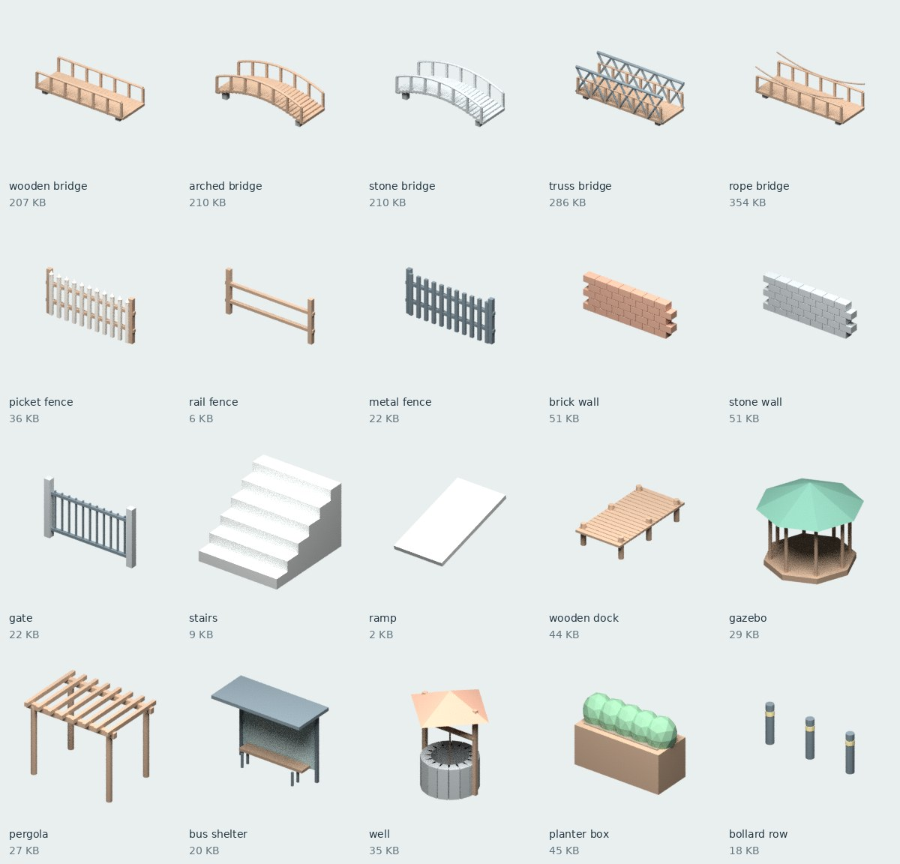

# Everyday GLB Library

**121点**の日常オブジェクトを収録した、オリジナルのローポリ素材集です。街、公園、庭、室内のプロトタイプやゲーム制作向け。

## ダウンロード

[assets](assets) から必要な `.glb` を選び、GitHub の **Download raw file** で保存してください。まとめて取得する場合は **Code → Download ZIP**。

**一括バックアップ:** [全121モデル＋生成スクリプト](everyday-glb-121.zip) / [全画像＋カタログ](catalog-previews.zip)。2つのZIPを同じフォルダに展開して利用できます。

ダウンロード後に `index.html` をブラウザで開くと、名前・カテゴリを検索できる画像カタログを使えます。オンライン3Dビューアではありません。

| カテゴリ | 点数 | 内容 | 一覧画像 |
|---|---:|---|---|
| [infrastructure](assets/infrastructure) | 20 | 橋5種、柵、門、壁、階段、スロープ、桟橋、東屋、パーゴラ、バス停、井戸など | [画像](previews/infrastructure.jpg) |
| [nature](assets/nature) | 21 | 広葉樹、桜、リンゴ、針葉樹、ヤシ、低木、花、岩、切り株、丸太、草など | [画像](previews/nature.jpg) |
| [signs](assets/signs) | 20 | 駐車場、バス停、速度標識、案内板、店舗看板、掲示板、道標など | [画像](previews/signs.jpg) |
| [street](assets/street) | 20 | ベンチ、ゴミ箱、街灯、信号機、消火栓、ポスト、自販機、噴水など | [画像](previews/street.jpg) |
| [furniture](assets/furniture) | 20 | 椅子、机、ソファ、本棚、ベッド、照明、冷蔵庫、洗濯機など | [画像](previews/furniture.jpg) |
| [props](assets/props) | 20 | 段ボール、木箱、樽、バケツ、植木鉢、食器、本、PC、工具など | [画像](previews/props.jpg) |



## 共通仕様

- **glTF 2.0 binary (.glb)**。色付きPBRマテリアルを内蔵、外部テクスチャ・外部ファイル不要。
- **1 unit = 1 meter / Y-up**。水平中心を原点に置き、最低点が地面 `Y=0` に接地します。Blenderへの読み込み時は自動で Z-up に変換されます。
- 静的モデル。カメラ・照明・アニメーション・コライダーは含めません。
- スタイライズ表現です。ガラスや水面は不透明色、看板文字はメッシュです。標識はゲーム用の簡略表現です。
- 各パーツは個別メッシュなので編集可能です。大量配置時は用途に応じてメッシュ統合、インスタンシング、LODを適用してください。
- [catalog.json](catalog.json) にパス・カテゴリ・寸法・ファイルサイズを収録。寸法の x/y/z は GLB 座標系です。
- 外部の既製3Dモデルや画像素材は使用していません。すべて同梱スクリプトから生成しています。

## 再生成

Blender **4.3.2** で生成・読み込み検証しています。プロジェクト直下で実行：

```sh
# 全カテゴリを再生成（GLB と各モデルの PNG）
blender -b -t 2 --python scripts/generate.py

# カテゴリ単位で再生成
blender -b -t 2 --python scripts/generate.py -- nature signs

# カタログ・一覧画像を更新（Python 3 + Pillow が必要）
python scripts/catalog.py

# バイナリ構造とジオメトリ参照を検査（Python 標準ライブラリのみ）
python scripts/validate.py

# Blenderへ全件再読み込みして接地とメッシュを確認
blender -b -t 2 --python scripts/check_import.py
```

乱数はモデル名から固定しています。プレビューは Cycles CPU / 24 samples。GPUや外部サービスは不要です。PNGは透明背景で、一覧画像のみ背景色を付けています。

## ファイル構成

- `assets/<category>/*.glb` — 使用するモデル本体
- `assets/<category>/manifest.json` — カテゴリ別メタデータ
- `previews/<category>/*.png` — 個別プレビュー（全件は画像ZIPにWebP形式で収録。PNGは再生成可能）
- `previews/<category>.jpg` — カテゴリ一覧
- `scripts/` — 再生成・カタログ作成・検証
- `index.html` — 画像を内蔵したオフライン検索カタログ

完成したカテゴリごとに main へチェックポイントを保存しています。
